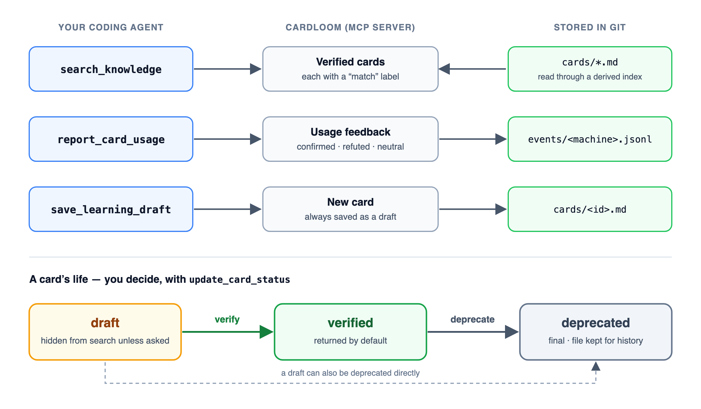

# cardloom-mcp

[](https://github.com/bangca85/cardloom-mcp/actions/workflows/ci.yml)

**Save engineering decisions and fixes your coding agent can look up later.** Give your agent
instructions to search before answering and to save new lessons as draft cards. Search returns verified
cards by default, and you decide what gets verified. Cards are plain markdown in a git repository, and
search is a local SQLite index with no LLM on the read path. It works with any MCP client, such as
Claude Code, Cursor or Codex.

## How it works

- **Cards.** One markdown file per lesson: a `decision`, `gotcha` (with the error message in
  `error_signature`), `pattern`, `playbook` or `snippet`, tagged with the stack, versions and project
  it applies to.
- **Lifecycle.** `draft → verified → deprecated`. An agent can only create drafts; a human approves
  (`verified`) or retires (`deprecated`) them. Deprecated is final and the file is kept for history. Merge promotion can optionally verify
  drafts whose source commit was merged.
  Search returns verified cards by default; drafts and deprecated cards only on request, always labelled.
- **Git is the source of truth.** `cards/*.md` and `events/*.jsonl` are committed locally. The SQLite
  index is derived and can be rebuilt at any time. Syncing between machines is an ordinary git
  push/pull that you run; the server never touches a remote.
- **Search.** Full-text search (SQLite FTS5) with matching on stack, version and project. Every result
  says how it matched, so an agent can tell a real hit from a loose one, and carries a trust score
  from usage feedback and age.
- **Checks on save and read.** Draft and deprecated content is labelled `untrusted` / `deprecated` in
  every response, secret patterns are rejected on save, and a card that conflicts with an existing
  one is refused instead of silently overwriting it.

The agent searches before it works, reports whether a card helped, and saves what it learned as a
draft. You decide what a draft becomes:

<p align="center">
  
</p>

## Tools

| Tool | What it does |
| --- | --- |
| `search_knowledge` | Find cards by keywords or a pasted error message; returns compact results with a `match` label. |
| `get_card` | Read one card in full (also available as the resource `knowledge://card/{id}`). |
| `save_learning_draft` | Save a new card as a draft. |
| `update_card_status` | Verify or deprecate a card; agents should call it only when you tell them to. |
| `report_card_usage` | Report whether a card helped: `confirmed`, `refuted` or `neutral`. |

There is also one prompt, `distill_project_knowledge`, which guides an agent through turning an existing
project's docs and history into draft cards.

## Quickstart

Five steps from an empty knowledge store to your first trusted card:

1. Register the server with Claude Code:

   ```bash
   claude mcp add cardloom -- npx -y cardloom-mcp
   ```

2. Run `npx cardloom-mcp doctor` to see the store path and card counts by status. If there are no
   verified cards, it points you back to this quickstart. The check is read-only.
3. Ask your agent to save one gotcha it just hit, for example: "Save what we learned about this
   error as a gotcha card, and put the exact error message in `error_signature`." The agent calls
   `save_learning_draft`; the card lands as `draft`.
4. Approve it in chat: "Verify that card." The agent calls `update_card_status` with action
   `verify`. Until you do this, the draft stays out of default search (see [Approving knowledge in chat](#approving-knowledge-in-chat)).
5. Search for it: ask the agent to call `search_knowledge` with the exact `error_signature` text you
   saved. With default settings the card comes back with `match: "exact_signature"`.

To label results for the repo you are working in, add a `.knowledge-map.yaml` at that repo's root
(details in [`.knowledge-map.yaml`](#knowledge-mapyaml--giving-the-agent-context-per-repo)):

```yaml
project: acme/billing-api
stack:
  - node
domain: backend
```

To have your agent use the tools without being asked each time, see
[Enforcing usage](#enforcing-usage-claudemd--agentsmd--geminimd).

## Setup

The server exposes the same five tools with each setup option.

Options 2 and 3 run from a clone: `git clone https://github.com/bangca85/cardloom-mcp.git && cd cardloom-mcp`.

### Option 1: npx (no clone, no Docker)

Needs Node 20, 22 or 24+ (CI runs 20 and 22). The launcher keeps your cards in
`~/.cardloom/knowledge-store` and the SQLite index in `~/.cardloom/index.db`; set
`KNOWLEDGE_STORE_PATH` / `INDEX_DB_PATH` to put them elsewhere.

```bash
claude mcp add cardloom -- npx -y cardloom-mcp
npx cardloom-mcp doctor   # read-only health check: store path, card counts by status
```

`claude mcp add` registers the server for the current project only; add `--scope user` to use it
everywhere (see [Set it up once for all projects](#set-it-up-once-for-all-projects)).

Other clients use the same command. Cursor (`~/.cursor/mcp.json`):

```json
{
  "mcpServers": {
    "cardloom": { "command": "npx", "args": ["-y", "cardloom-mcp"] }
  }
}
```

Codex (`~/.codex/config.toml`):

```toml
[mcp_servers.cardloom]
command = "npx"
args = ["-y", "cardloom-mcp"]
```

The SQLite driver (`better-sqlite3`) ships prebuilt binaries for common platforms; elsewhere npm
compiles it, which needs a C++ toolchain.

### Option 2: Docker

1. Build the server:

   ```bash
   npm install
   npm run build
   ```
2. Build the container image:

   ```bash
   docker compose build
   ```
3. Register the server with your MCP client using the wrapper script at `bin/cardloom-mcp.sh` —
   **use an absolute path**, since MCP clients spawn the command with an arbitrary working
   directory and the wrapper needs to find `docker-compose.yml` regardless.

   **Claude Code:**

   ```bash
   claude mcp add cardloom -- /absolute/path/to/cardloom-mcp/bin/cardloom-mcp.sh
   ```

   **Cursor** (`~/.cursor/mcp.json`):

   ```json
   {
     "mcpServers": {
       "cardloom": {
         "command": "/absolute/path/to/cardloom-mcp/bin/cardloom-mcp.sh"
       }
     }
   }
   ```

   **Codex CLI / Codex extension (VS Code)** (`~/.codex/config.toml`):

   ```toml
   [mcp_servers.cardloom]
   command = "/absolute/path/to/cardloom-mcp/bin/cardloom-mcp.sh"
   args = []
   ```

   Or via the Codex Settings UI → **MCP servers → Connect to a custom MCP** (writes to the
   same `config.toml`): Name `cardloom`, Type `STDIO`, Command to launch =
   `/absolute/path/to/cardloom-mcp/bin/cardloom-mcp.sh`, leave Arguments/Environment
   variables/Working directory empty, Save.
4. Verify: ask your client to list MCP tools. You should see exactly 5 — `search_knowledge`,
   `get_card`, `save_learning_draft`, `update_card_status`, `report_card_usage` — plus one
   resource template, `knowledge://card/{id}`, and one Prompt, `distill_project_knowledge`
   (see [Ingesting an existing project](#ingesting-an-existing-project)).

Each MCP session starts a fresh container (`docker compose run --rm -i`) that exits when the client
disconnects. Cards live in `./knowledge-store` (a bind mount: human-editable and git-tracked). The SQLite
index lives in a separate named Docker volume, because a SQLite file on a macOS bind mount is unreliable;
never touch it by hand, it is fully disposable and rebuilds from `knowledge-store/` (see
`npm run rebuild-index`).

### Option 3: Native from a clone (no Docker)

Docker on macOS runs a Linux VM (Virtualization.framework) underneath, which reserves several GB
of RAM regardless of how small the container's own workload is. The server itself is light —
measured at ~100MB RSS for the MCP process and ~71MB for the web viewer, both idle at 0% CPU — so
running directly on the host with plain `node` skips the VM overhead entirely.

```bash
npm install
npm run build
```

Register the server with your MCP client using `node` directly instead of the Docker wrapper:

```json
{
  "mcpServers": {
    "cardloom": {
      "command": "node",
      "args": ["/absolute/path/to/cardloom-mcp/dist/index.js"],
      "env": {
        "KNOWLEDGE_STORE_PATH": "/absolute/path/to/cardloom-mcp/knowledge-store",
        "INDEX_DB_PATH": "/absolute/path/to/cardloom-mcp/.metadata/index.db"
      }
    }
  }
}
```

Trade-off: you lose container isolation, and `git commit`s use your host's git config. The SQLite
index and its write lock live on your local filesystem, so there is no bind-mount quirk to worry about.

## Configuration

Every setting is an environment variable and every one is optional.

| Variable | Default | Meaning |
| --- | --- | --- |
| `KNOWLEDGE_STORE_PATH` | `~/.cardloom/knowledge-store` with `npx`, `./knowledge-store` otherwise | Where cards (`cards/`), usage events (`events/`) and your benchmark live. It is its own git repository. |
| `INDEX_DB_PATH` | `~/.cardloom/index.db` with `npx`, `<store>/.metadata/index.db` otherwise | The SQLite index. Derived data, safe to delete. |
| `SEARCH_FALLBACK` | `tiered` | `tiered`: when exact-word search finds fewer than `limit` cards, add partial matches labelled `related`. `off`: exact-word search only. |
| `SEARCH_RANKING` | `baseline` | Result order: `baseline` or the opt-in `x` / `y`. See [How search works](#how-search-works). |
| `STALE_THRESHOLD_DAYS` | `180` | A verified card older than this is flagged `stale`. |
| `REVIEW_FAILURE_THRESHOLD` | `2` | A card with this many `refuted` reports is flagged `needs_review`. |
| `REVIEWER_NAME` | `human-reviewer` | Recorded as `verified_by` when a card is approved. |
| `KNOWLEDGE_MACHINE_ID` | the host name | Names this machine's usage log (`events/<id>.jsonl`) so two machines never write the same file. |
| `PROMOTION_MODE` and the other `PROMOTION_*` | see [Merge promotion](#merge-promotion-npm-run-promote-merged) | Control `npm run promote-merged`. |
| `PORT` | `3334` | Web viewer port. |
| `GRAPH_GENERIC_STACK_TAGS`, `MAX_SHARED_STACK_GROUP_SIZE`, `MAX_SHARED_STACK_EDGES` | empty, `50`, `5000` | Web viewer graph tuning. |

## How search works

`search_knowledge(query, context)` takes keywords or a pasted error message. `context` carries the
calling repo's `stack`, `versions`, `project` and `aliases` (see
[`.knowledge-map.yaml`](#knowledge-mapyaml--giving-the-agent-context-per-repo)).

Each result says how it matched:

| `match` | Meaning |
| --- | --- |
| `exact_signature` | The card's `error_signature` appears in your query. It is checked on the stored text, so `ERR-42` does not match `ERR_42`. |
| `exact_identifier` | Your query contains an identifier from the card's `error_signature`, such as `ITMS-90683` or `AccessDeniedException`. |
| `exact_title` | Your query is the card's whole title. |
| `all_terms` | Every word of your query is in the card. |
| `related` | Only some of the words match. |

When all returned cards are partial matches, the response includes `no_direct_match: true`. Use those
cards as leads for a follow-up search, not as an answer. Set `SEARCH_FALLBACK=off` to get only cards that
match all words.

By default only `verified`, non-restricted cards are returned. `include_drafts`, `include_deprecated` and
`include_restricted` opt in, and those cards are always labelled. Each result also carries a `trust` score
and flags: `drift` (the card's version range does not match the caller's), `stale` and `needs_review`.
With a `project` in the context, results also say whether a card belongs to this project, is shared, or
applies to another project; cards for other projects are never hidden.

**Ranking.** The default (`SEARCH_RANKING=baseline`) orders results by stack and version match, then text
relevance, then trust. The `x` and `y` modes also rank by project. They are opt-in because, in our
benchmark, putting the project ahead of the text score pushed exact matches from shared cards below weaker
matches from the caller's own project. Run `npm run benchmark -- --matrix` against your own store before
enabling them.

## `.knowledge-map.yaml` — giving the agent context per repo

Add a `.knowledge-map.yaml` to the root of each project you work on. Your agent reads it and passes the
project and stack details to `search_knowledge`, so results are matched against your stack and versions:

```yaml
# .knowledge-map.yaml — lives in the root of each project repo you work in
project: acme/billing-api
aliases:            # optional: other names this project has had in existing cards
  - billing-api
stack:
  - nextjs@15
  - postgres@16
  - node
domain: backend
```

`project:` is the key the agent passes as `context.project` (and `aliases:` as `context.aliases`)
so results are labelled by scope (this project, shared, other project); they are ranked by project
only when `SEARCH_RANKING` is set to `x` or `y`. Cards for other projects are never hidden.
Older maps that use `repo:` instead of `project:` are still accepted by clients.

Workflow for a brand-new repo:

1. Ask the agent to inspect the repo (package.json, lockfiles, etc.) and generate a **draft**
   `.knowledge-map.yaml`.
2. Review and edit it yourself — fix wrong stack detection, add domain hints.
3. Commit it into the project repo (not `cardloom-mcp`).
4. Point your agent/client at it so `search_knowledge` calls include `context: {stack, versions, project, aliases}`
   read from that file.

## Enforcing usage (CLAUDE.md / AGENTS.md / GEMINI.md)

Nothing forces the agent to call these tools — MCP tools only fire when the model decides to. To have
your agent search before answering, report whether a card helped, and save new lessons as drafts, give it
the instructions below, in either of two places:

- **Globally, once for every project:** put the block in your client's global instructions file. See
  [Set it up once for all projects](#set-it-up-once-for-all-projects).
- **Per project:** put it in the repo's own `CLAUDE.md` (Claude Code), `AGENTS.md` (Codex) or `GEMINI.md`
  (Gemini CLI). Codex does not read `CLAUDE.md`, and Gemini CLI reads `AGENTS.md` only if you list it in
  `context.fileName`. If several clients work in the repo, add the block to each client's file.

Use one place or the other: the same block in both only costs tokens.

````markdown
## Knowledge Hub (MCP `cardloom`) — required

**Before answering/implementing a task touching a known domain** (auth, rate-limiting,
third-party API contracts, infra gotchas, etc.): call `search_knowledge(query, context)` first,
with `context` read from `.knowledge-map.yaml` at this repo's root (`stack`, `versions`, and
`project` / `aliases` so results are labelled for this repo). A result with `match: related`,
or a response with `no_direct_match: true`, is a partial match: use it as a lead for another search, not as an answer.
**If that file doesn't exist yet**, generate a draft yourself before proceeding — inspect this
repo's manifest (package.json / pubspec.yaml / go.mod / requirements.txt, lockfiles) for the
real stack + versions, write it in this shape, then ask the human to review before you rely on it:

```yaml
# .knowledge-map.yaml — repo root, human-reviewed after you draft it
project: <owner/repo-name>
aliases: []   # optional: other names this project has had in existing cards
stack:
  - <tech>@<version>
  - <tech>@<version>
domain: <frontend|backend|infra|product|...>
```

Don't re-derive something a `verified` card already answers.

**After using a returned card — you MUST call `report_card_usage(id, outcome)`**
(`confirmed`/`refuted`/`neutral`). This is not optional — every search/get_card response carries
a `write_back_reminder`; skipping it lets trust scores and `needs_review` flags drift stale.

**Learned something new** (a decision, pattern, or gotcha with no existing card, or a refinement
of an existing one) → call `save_learning_draft`. It always lands as `draft` — never verify it
yourself. Put a bare commit sha in `source_commit` and the repo's GitHub `owner/name` in
`source_repo` whenever the learning comes from a commit: that is what lets merge promotion find
it. Free text there ("working tree", "local changes") means the card can only ever be approved by hand.

**Found a major mismatch between a `verified` card and current reality** (the card says A, the
code/logs/API actually do B — a real contradiction, not a nuance): **stop, don't silently trust
either side.** Lay out:

- which card, what it currently claims (`id` + summary)
- what you actually observed (specific file/log/response)
- the two possible resolutions: the card is stale/wrong → deprecate it + save a new card with
  `supersedes`, or the code is the regression → fix the code and leave the card as-is

then ask for confirmation on which direction before calling `update_card_status` or
`save_learning_draft(supersedes=...)`. Don't decide alone when the mismatch affects an
architecture or security call.
````

### Set it up once for all projects

Register the server for every project, and put the instruction block above in the client's global file:

| Client | Register the server for all projects | Global instructions file |
| --- | --- | --- |
| Claude Code | `claude mcp add --scope user cardloom -- npx -y cardloom-mcp` | `~/.claude/CLAUDE.md` |
| Codex (OpenAI's coding agent) | `codex mcp add cardloom -- npx -y cardloom-mcp` | `~/.codex/AGENTS.md` |
| Gemini CLI | `gemini mcp add --scope user cardloom npx -y cardloom-mcp` | `~/.gemini/GEMINI.md` |

- **Scope matters.** `claude mcp add` and `gemini mcp add` register the server for the current project
  only unless you pass `--scope user`, so the Quickstart command is project-scoped. `codex mcp add` writes
  `~/.codex/config.toml`, which is already global.
- **Codex.** Use `~/.codex/AGENTS.override.md` for a temporary global override without touching the base
  file. If you set `CODEX_HOME`, both files live there instead of `~/.codex`.
- **Gemini CLI.** You can also add the server by hand to `~/.gemini/settings.json` (merge it with what is
  already there):

  ```json
  { "mcpServers": { "cardloom": { "command": "npx", "args": ["-y", "cardloom-mcp"] } } }
  ```

  To make Gemini CLI read an `AGENTS.md` as well, set `"context": { "fileName": ["AGENTS.md", "GEMINI.md"] }`
  in the same file.
- **ChatGPT.** The ChatGPT chat apps do not read these files; Codex is the OpenAI client covered here.
- **Check it worked.** Run `claude mcp list`, `codex mcp list` or `gemini mcp list` and look for `cardloom`,
  then ask the agent to list its MCP tools. In Gemini CLI, `/memory show` prints the instructions it loaded.

## Approving knowledge in chat

Every card an agent saves via `save_learning_draft` starts in `status: draft` and stays out of default search
until it is verified. To promote or retire one:

- **Approve:** tell the agent to approve a card; it calls
  `update_card_status(id, "verify")`. Status flips to `verified`, and if the card declared
  `supersedes: <old-id>`, the old card is deprecated in the *same* operation (one commit).
- **Reject / retire:** tell the agent to deprecate a card with a reason; it calls
  `update_card_status(id, "deprecate", reason)`. The file is kept (a retired card is never
  deleted) and disappears from default search, but stays readable via `get_card`.

`deprecated` is terminal — there's no un-deprecate. To bring a retired idea back, save a new card
with `supersedes` pointing at the old one and approve it.

## Ingesting an existing project

Use the built-in prompt `distill_project_knowledge` to turn a repo's docs, architecture decisions, git
history and debug logs into draft cards:

- Invoke it from any MCP client that supports prompts (Claude Code does), optionally with `project_path`
  (defaults to the current directory), and let the agent run it.
- The prompt instructs the agent to enumerate sources exhaustively (not just CLAUDE.md's
  condensed summaries — the full numbered decision list a summary points at, every story file's
  Debug Log section, full git history, claude-mem if present), report a source survey with
  an estimate of how many lessons each source contains *before* saving anything, dedupe against existing verified cards via
  `search_knowledge` (using `supersedes` where a lesson is refined rather than new), and present
  cards in small batches for you to approve.
- All cards still land in `draft` — nothing gets `verify`d without you approving in chat.

## Merge promotion (`npm run promote-merged`)

`promote-merged` finds drafts whose source commit reached its repo's default branch after the draft was
written. By default it lists them for you to approve; in `auto` mode it verifies the eligible ones itself.
It runs on the host because it reads your other clones and calls `gh`, which the container cannot.

| `PROMOTION_MODE` | What happens |
| --- | --- |
| `off` | Nothing. |
| `review` (default) | Lists merged drafts as candidates. You approve in chat; the agent calls `update_card_status(id, "verify", verification_method="<evidence>+chat-approval")`. |
| `auto` | Verifies the eligible ones itself, `verified_by: merge-bot`, `verification_method: merged:<repo>@<sha> (<via> <date>)`. Lists the rest as candidates. |

**"Merged" means the commit entered the default branch AFTER the card was written** (card date =
its `knowledge: add` commit in the store). A card about code already on `main` records main's
HEAD, which is trivially "merged"; counting that would verify every observation on save. How a
commit's arrival is dated: on the first-parent line → its own date; brought in by a merge → the
merge commit's date; not in the clone at all (squash merge) → the GitHub pull request's `merged_at`.
A commit pushed straight to the default branch also counts: that is evidence about the commit's history,
not proof that anyone reviewed the card.

`auto` never verifies, and always leaves as a candidate:

- a type outside `PROMOTION_AUTO_TYPES` (default `decision,pattern` — a merge is evidence about
  the change itself, not about a third-party system a gotcha describes);
- a `restricted` card;
- a card with `supersedes` — verifying it deprecates the old card, and an unapproved draft
  must never kill a verified card.

Skipped outright: `source_commit` without a sha, a learning from uncommitted work on top of a sha,
a commit not merged yet, a repo that cannot be found.

| Env | Default | Meaning |
| --- | --- | --- |
| `PROMOTION_MODE` | `review` | `off` / `review` / `auto`; anything else reads as `review` |
| `PROMOTION_REPO_ROOTS` | — | `:`-separated dirs scanned 3 levels deep for clones named like the card's repo |
| `PROMOTION_AUTO_TYPES` | `decision,pattern` | card types `auto` may verify |
| `PROMOTION_FETCH` | `1` | `git fetch origin` each matched clone first; `0` = trust its current refs |
| `PROMOTION_BOT_NAME` | `merge-bot` | `verified_by` written by `auto` |

```bash
npm run build
npm run promote-merged -- --dry-run          # auto mode prints would_verify, writes nothing
npm run promote-merged -- --mode=review --json
```

> Note: an auto-verified card can be undone only like any verified card — `deprecate` it, or
> `git revert` its `knowledge: verify` commit in the store and `npm run rebuild-index`.
> There is no way back to `draft`.

## Host sync (git push/pull)

The server **only commits locally**: it never pushes, pulls, or touches remotes or SSH keys, so
credentials never need to be inside the Docker container. To sync between machines, run
`git pull --rebase` and `git push` from your host. Use the path of your store: `~/.cardloom/knowledge-store`
with `npx`, or `<clone>/knowledge-store` otherwise.

```bash
# ~/.zshrc or ~/.bashrc
alias ksync='git -C ~/.cardloom/knowledge-store pull --rebase && git -C ~/.cardloom/knowledge-store push'
```

Run `ksync` whenever you switch machines, or automate it with `cron`/`launchd`:

```cron
# crontab -e — sync every 15 minutes
*/15 * * * * git -C /path/to/your/knowledge-store pull --rebase && git -C /path/to/your/knowledge-store push
```

Set up `knowledge-store` as its own git repo with a private remote (GitHub, etc.) from the
**host**, not from inside the container:

```bash
cd ~/.cardloom/knowledge-store   # or <clone>/knowledge-store
git remote add origin git@github.com:you/your-private-knowledge.git
git push -u origin HEAD
```

Do not commit your real `knowledge-store/` to this project repository. It can contain private
project names, decisions, error logs, source references, and SQLite runtime files. Keep it in a
separate private repo or local-only directory.

## Web viewer

A local List and Graph view of your cards, served at `http://127.0.0.1:3334`. From a clone run
`npm run web` (with the same `KNOWLEDGE_STORE_PATH` and `INDEX_DB_PATH` as the server); with Docker run
`docker compose up cardloom-web`. The `npx` launcher starts only the MCP server.

## Rebuilding the index

If `index.db` ever goes missing or looks wrong, rebuild it from scratch — `cards/*.md` and
`events/*.jsonl` are the only source of truth, the index is 100% derived and disposable:

```bash
npm run build && npm run rebuild-index
# or, in the container:
docker compose run --rm cardloom-mcp npm run rebuild-index
```

## Benchmark

Your benchmark is `benchmark/queries.yaml` inside your store, committed alongside your cards. It is a
plain YAML list:

```yaml
- query: "how do I retry a failed network request"
  expected: pattern-retry-with-backoff       # card id this query should return as top-1
  context:                                    # optional, same shape as search_knowledge's context
    stack: [node]
- query: "TypeError: Cannot read property 'foo' of undefined"
  expected: gotcha-foo-undefined-crash
```

Each entry may also carry a `kind` (default `known`, so entries with just `query` + `expected` keep
working), an `expected` list, and `forbidden` ids:

```yaml
- query: "retry policy for payments"
  kind: project_decision                      # known | missing | project_decision | cross_project
  expected: decision-payments-retry
  forbidden: [decision-billing-retry]         # top-1 here counts as a wrong-project answer
  context: { project: acme/payments-api, stack: [node] }
- query: "how do we shard the queue"
  kind: cross_project
  expected: [pattern-queue-sharding, gotcha-hot-partition]   # recall@5 counts any of these
- query: "zqxv7000 error"
  kind: missing                               # no card should answer this; no `expected`
```

Per kind the report gives `n` plus: `known` / `cross_project` hit@1, MRR@5, recall@5 (any id in
`expected`); `missing` `falseAnswerRate` (share whose top-1 is not labelled `related`) and
`anyResultRate` (share returning at least one result); `project_decision` hit@1 and
`wrongProjectTop1Rate` (share whose top-1 is in `forbidden`). To compare ranking modes before changing
`SEARCH_RANKING`, look at `wrongProjectTop1Rate` (project_decision) and recall@5 (cross_project).

`--synthetic` skips `queries.yaml` and derives a suite from the store (verified + normal cards
only): `title` (verbatim), `title_nl` (the first seven title words inside a question template), `sig_noisy` (a noisy pasted
error line, gotchas only) and 100 `missing` queries built from fabricated tokens, each checked to
have zero full-text hits. `--matrix` runs the same queries under `baseline/off`,
`baseline/tiered`, `x/tiered` and `y/tiered` (ranking/fallback) and prints one row per config:

```bash
npm run build && npm run benchmark -- --synthetic --matrix
```

Write queries the way you'd actually ask — real questions, real pasted error messages — each
pointing at the card id you expect to come back first. Multiple queries can point at the same
card.

Run it:

```bash
npm run build && npm run benchmark
# or, in the container:
docker compose run --rm cardloom-mcp npm run benchmark
```

Each run builds its own throwaway in-memory index from the card files in the store (it never
reads `index.db`, so a stale index cannot produce a false score), then prints a corpus fingerprint
line (card count, verified count, sha256 over `id|status|file_mtime`) before the report.

It runs every query through the exact same `search_knowledge` ranking path (no separate scoring
logic to drift out of sync) and reports top-1 hit rate, p50/p95 latency, and a list of misses. A
low hit rate is a signal to add facets or fix a card, not a failure. If any `expected` or `forbidden` card id in
`benchmark/queries.yaml` has no card in the store, the benchmark lists those ids and exits with
code 2 without scoring. Expected ids that exist but default search would never return (not
`verified`, or `restricted`) only print a warning. Other operational problems (corrupt YAML, unreadable store) exit 1. If
`benchmark/queries.yaml` doesn't exist yet, it says so and exits cleanly instead of erroring.

## Commands

```bash
npm run build          # tsc
npm run dev            # tsx watch src/index.ts (runs on the host, no Docker)
npm test                # vitest run
npm run rebuild-index   # rebuild index.db from cards/ + events/
npm run benchmark       # measure top-1 hit rate + latency against benchmark/queries.yaml
npm run doctor          # read-only store health check (path, git, card counts by status)
npm run web             # local web viewer (List / Graph view) on http://127.0.0.1:3334
npm run promote-merged  # list or verify drafts whose source commit was merged
docker compose build && docker compose run --rm -i cardloom-mcp
```

## Contributing, security, license

- **Contributing:** see [CONTRIBUTING.md](CONTRIBUTING.md). Never commit a real `knowledge-store/`, SQLite
  files or local agent settings; use synthetic cards in tests and examples.
- **Security:** report vulnerabilities privately as described in [SECURITY.md](SECURITY.md). Treat
  unreviewed cards as untrusted content.
- **License:** [ISC](LICENSE).
